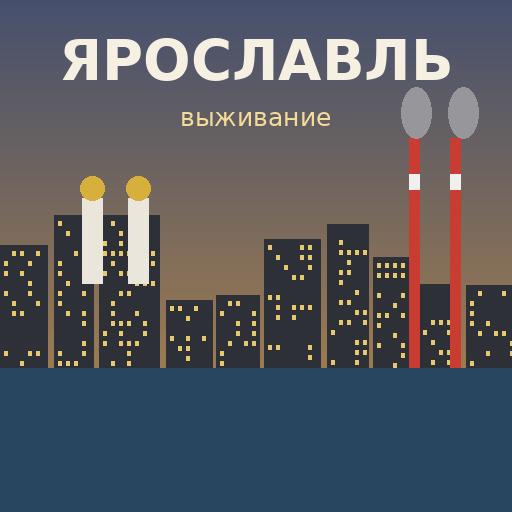

# Ярославль: Выживание — сборка для Project Zomboid (Build 42)



- **`YaroslavlSurvival/`** — мод с русским контентом. Внутри:
  - оружие: АК-74, АКС-74У, ПМ, СКС, Мосинка, ТОЗ-34, сапёрная лопатка;
  - свои калибры и магазины;
  - советская еда, вещи и интерьер;
  - ловушки (капкан, растяжка, доска с гвоздями);
  - камеры наблюдения с монитором;
  - «полузаброшенный город»: открытые квартиры, разбитые окна.
- **[`docs/SBORKA.md`](docs/SBORKA.md)** — пошаговая инструкция:
  - вид от первого лица (Project Viewpoint + эффект нагрудной камеры);
  - как собрать карту Ярославля из OpenStreetMap через KnoxMap;
  - настройки песочницы.

## Быстрая установка мода

Скопируйте `YaroslavlSurvival/Contents/mods/YaroslavlSurvival` в `~/Zomboid/mods/`
(на Windows `C:\Users\<имя>\Zomboid\mods\`). Затем в игре: Моды → **Yaroslavl Survival**.

## Структура

```
YaroslavlSurvival/
├── workshop.txt, preview.png              ← для публикации в Steam Workshop
└── Contents/mods/YaroslavlSurvival/
    ├── common/media/textures/             ← иконки предметов (Item_YS_*.png)
    └── 42/
        ├── mod.info, poster.png, icon.png
        └── media/
            ├── registries.lua             ← калибры 5,45 / 7,62x39 / 7,62x54R / 9x18
            ├── scripts/                   ← предметы и рецепты
            └── lua/
                ├── shared/YS_Config.lua   ← все настраиваемые числа
                ├── server/YS_Distributions.lua, YS_Abandoned.lua
                └── client/YS_Traps.lua    ← ловушки и камеры
```

Статус: версия 0.1.0. Мод написан по документации Build 42.13+, но в самой игре ещё не
запускался. Своих 3D-моделей оружия пока нет, используются ванильные.

Данные карт © участники OpenStreetMap (ODbL).
